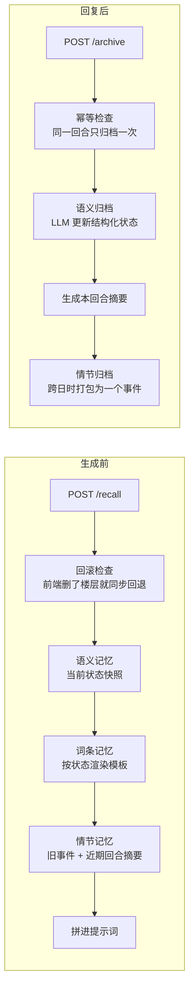

# MAAS — 角色对话的记忆后端（原型）

> **状态：已归档。** MAAS 是 2026 年 4–7 月做的技术原型，用来验证「长对话的记忆该怎么拆、怎么流转」。验证过的设计后来并入了全栈应用 **LoreNook**（分层摘要、状态规则、多用户隔离、Vue 3 前端、公网部署），本仓库不再更新。

长对话里，模型记不住几十轮之前发生的事，上下文又不能无限变长。MAAS 是一个独立的 HTTP 服务，夹在聊天前端和大模型之间：**生成前**告诉前端该把哪些记忆放进提示词，**回复后**把这一轮对话整理进记忆。

技术栈：Python 3.11+ · FastAPI · 异步 SQLAlchemy（aiosqlite）· Pydantic · Jinja2 · 任意 OpenAI 兼容的 LLM 接口

## 两条流水线



## 三种记忆

| 模块 | 存什么 | 怎么用 |
| --- | --- | --- |
| 情节记忆 `episodic` | 每回合一句摘要；剧情跨日时，把之前的回合打包成一个「事件」并生成事件摘要 | 召回时最近若干回合给摘要、更早的只给事件摘要，上下文不会随对话线性膨胀 |
| 语义记忆 `semantic` | 按角色 Schema 定义的结构化状态（如日期、地点、关系数值），每回合由 LLM 增量更新并校验 | 作为状态快照注入；它的「日期」字段也是情节记忆判断跨日的依据 |
| 词条记忆 `lorebook` | YAML 定义的设定词条，可含 Jinja2 模板 | 用当前语义状态渲染后按位置和深度注入 |

三个模块通过 `enabled_modules` 独立开关（情节记忆在未启用语义记忆时，每回合都视为跨日）。

## 值得一提的设计

- **前端删楼层时自动回滚。** 召回时比对前端最新回合号与库内最大回合号，若前端删过消息，就把受影响的回合、事件和语义快照一并回退，保证记忆里没有「已被删除的剧情」。
- **归档幂等。** 同一回合号重复提交直接跳过，前端重试不会写出重复记忆。
- **一天之内的事不拆开。** 事件边界以剧情内日期切换为准，并始终留一个最新回合到下次，避免把正在进行的场景切成两半。
- **语义更新失败则整轮不落库。** 状态和摘要要么一起写入，要么都不写。
- **Mock 模式。** `MAAS_LLM_MOCK_MODE=true` 时不调用外部模型，便于本地联调。
- 设计取舍记录在 [`docs/ADR/`](docs/ADR/)：总述、情节、语义、词条各一份（早期版本，部分细节以代码为准）。

## 目录

```
api/          HTTP 接口层（参数校验、路由）
schemas/      请求/响应模型（Pydantic）
core/         召回、归档、回滚三条主流程的编排
modules/      episodic / semantic / lorebook 三个记忆模块（各自含 recall / archive / prompts）
repository/   数据库引擎、ORM 模型、CRUD
shared/       LLM 客户端（超时与重试）、摘要生成、提示词渲染
docs/         ADR 设计文档、前端对接说明
```

## 本地运行

```bash
python -m venv .venv
source .venv/bin/activate          # Windows: .venv\Scripts\activate
pip install -r requirements.txt
cp .env.example .env               # 填写 MAAS_LLM_*，或设 MAAS_LLM_MOCK_MODE=true
uvicorn main:app --reload
```

启动后自动建表；Swagger 在 `/docs`，ReDoc 在 `/redoc`，健康检查 `GET /health`。

常用配置（环境变量或 `.env`，统一 `MAAS_` 前缀）：

| 变量 | 默认值 | 说明 |
| --- | --- | --- |
| `MAAS_DATABASE_URL` | `sqlite+aiosqlite:///./maas.db` | 数据库 |
| `MAAS_LLM_ENDPOINT` / `MAAS_LLM_MODEL` / `MAAS_LLM_API_KEY` | — | OpenAI 兼容接口 |
| `MAAS_LLM_TIMEOUT_SECONDS` | `30.0` | 单次请求超时 |
| `MAAS_LLM_MAX_RETRIES` | `2` | 失败重试次数 |
| `MAAS_LLM_MOCK_MODE` | `false` | 不调用外部模型 |

启用 `semantic` 需要角色 Schema `data/{chat_id}.py`；启用 `lorebook` 需要词条目录 `lorebook/{chat_id}/`。

## 对接流程

1. `POST /api/v1/chats` 初始化对话，指定 `enabled_modules`
2. 用户发言后 `POST /api/v1/recall`，把返回的记忆拼进提示词
3. 模型回复后 `POST /api/v1/archive`
4. 排查用：`/api/v1/chats/{chat_id}/rounds`、`/episodes`、`/semantic`

```json
{
  "chat_id": "demo",
  "first_message": "你好，今天想聊点什么？",
  "enabled_modules": ["episodic"]
}
```

前端字段与时序的完整说明见 [`docs/api_frontend.md`](docs/api_frontend.md)。

## 协议

[MIT](LICENSE)。
